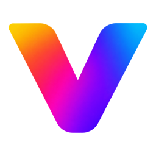

<p align="center"></p>
<h1 align="center">Vestra Player Plugins</h1>
<p align="center"><b>The plugins in the Vestra Player store: their source, and the signed index the store reads.</b></p>
<p align="center">
  <a href="https://github.com/vestrasys/vestra-player-plugins/actions/workflows/ci.yml"></a>
  <a href="https://github.com/vestrasys/vestra-player-plugins/actions/workflows/publish.yml"></a>
  <a href="https://vestrasys.github.io/vestra-player-plugins/index.json"></a>
  <a href="https://www.npmjs.com/package/@vestra-player/sdk"></a>
  <a href="LICENSE"></a>
</p>

## Plugins

To install one, open the store in [Vestra Player](https://github.com/vestrasys/vestra-player).

| Plugin | Id | What it does |
| --- | --- | --- |
| [AMD Motion Smoothing](plugins/amdmotion) | `zysilm.amdmotion` | Smoother motion with real in-between frames from your AMD Radeon GPU |
| [Auto Frame](plugins/autoframe) | `zysilm.autoframe` | Crops away the solid-colour border around a video's picture |
| [Clip Export](plugins/clipexport) | `zysilm.clipexport` | Cut part of a video into a new file: a lossless stream copy, a re-encoded MP4, or an animated GIF or WebP |
| [Shader Upscale](plugins/shaderupscale) | `zysilm.shaderupscale` | Real-time GPU upscaling with mpv GLSL shaders: Anime4K for anime; AMD FSR 1, RAVU and FSRCNNX for live action |
| [VestraNES](plugins/vestranes) | `zysilm.vestranes` | Play NES games in the player, with the keyboard |
| [VestraTube](plugins/vestratube) | `zysilm.vestratube` | Search YouTube in the sidebar and play videos right away |

These are third-party plugins. The player's built-in plugins (playback, playlist, subtitles, …) ship with the player and live in [its repository](https://github.com/vestrasys/vestra-player/tree/main/src/plugins).

## Write a plugin in 5 minutes

A plugin is a folder with a `manifest.json` and TypeScript on the [`@vestra-player/sdk`](https://www.npmjs.com/package/@vestra-player/sdk) API (Node.js 26).

1. Follow [Getting started](https://vestrasys.github.io/vestra-player-sdk/documents/Getting_started.html) in the SDK documentation: a first plugin with a window, tests and a package.
2. Check, test and pack it:

   ```sh
   npx vestra-plugin check    # validate manifest.json, strict type check
   npx vestra-plugin test     # node --test on tests/*.test.{ts,mjs}
   npx vestra-plugin pack     # build dist/ and pack <id>-<version>.vxp
   ```

3. Try it: start Vestra Player with `--plugin <folder>`.

The plugins in [`plugins/`](plugins) are complete examples. More: [SDK documentation](https://vestrasys.github.io/vestra-player-sdk/), [API reference](https://vestrasys.github.io/vestra-player-sdk/modules.html).

## Submit it to the store

A plugin gets into the store through a pull request that adds its source to this repository:

1. Fork this repository and put your plugin folder in `plugins/<name>/`. Set its id to `<your GitHub login>.<name>` and add `<name> = "<your GitHub login>"` to [`plugins/owners.toml`](plugins/owners.toml).
2. Run the repository's checks: `npm ci`, then the one command in [CONTRIBUTING.md](CONTRIBUTING.md#run-the-checks).
3. Open a pull request titled `Add <id>`. CI runs the same checks on macOS, Windows and Linux, and a maintainer reads the source.

When it is merged, CI packs the plugin, publishes it and adds it to the signed index; it then appears in the store. To update it, bump `version`, add a `CHANGELOG.md` entry and open another pull request.

[CONTRIBUTING.md](CONTRIBUTING.md) is the full checklist of what CI and the reviewer look for.

Registering a plugin that stays in your own repository is planned and not available yet.

## Maintainers

CI, security review, publishing, the index format, the signing key, revocation and retirement: [MAINTAINING.md](MAINTAINING.md). To report a vulnerability: [SECURITY.md](.github/SECURITY.md).

## License

[Apache-2.0](LICENSE), including the plugins in `plugins/`. Third-party files bundled in a plugin keep their own licenses ([rules](CONTRIBUTING.md#third-party-files-and-licenses)).
